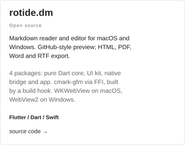
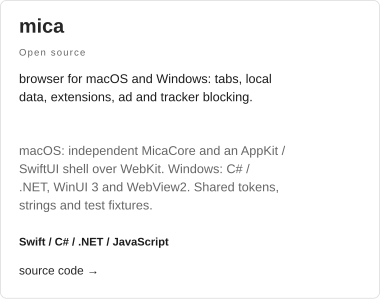
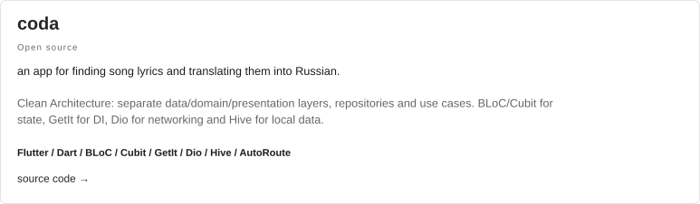

<strong>English</strong> | <a href="README.ru.md">Русский</a>

Ernest Tryakin, full-stack developer based in Ufa, Russia. I build apps for iOS, Android, macOS, Windows and the web with **Flutter, Dart and Swift**, and backends, integrations, bots and developer tools with **TypeScript, Python and C#**. I own a product end to end: from the data model and interface to infrastructure and store releases.

## Why me

1. **The full cycle in one pair of hands:** data model, backend, client, infrastructure and release. At Bazik I'm the only full-stack developer, so decisions don't get lost between people and teams.
2. **Depth, not just assembly from off-the-shelf parts:** a custom document editor, syntax highlighting, export, native bridges, a design system. When the ready-made option doesn't fit, I build my own.
3. **One architecture, many platforms:** iOS, Android, macOS, Windows and the web on a shared core and shared client/server contracts.
4. **Product, not only code:** I think about user scenarios, screen states and the path to release, and I cover the logic with tests.
5. **Cleaning up AI slop:** I bring code to a deliberate architecture, strip the generic AI look from interfaces and deliver pixel-perfect design.
6. **Skills for autonomous work:** I write custom skills so AI agents work independently and predictably.
7. **Real releases:** Tvaity and Kerla are published in the stores, and Bazik was launched together with the company.

## Tech stack

**Languages**

**UI frameworks**

**Web interfaces and state management**

**Backend & APIs**

**Databases & search**

**Database tools**

**Infrastructure & integrations**

**AI**

**Development tools**

### Architecture, integrations & releases

**Architecture:** Clean Architecture, MVVM, feature-based modules, DI, shared client/server contracts, platform bridges and FFI. 
**Data:** SQL, migrations, indexes, transactions, multi-tenancy, Prisma, Entity Framework Core, SQLAlchemy, Hive, SharedPreferences. 
**Integrations:** REST APIs, WebSocket, Dio, go_router, FCM, APNs, RuStore Push, S3, Yandex Object Storage, Telegram Bot API, Bitrix24. 
**AI:** RAG, embeddings, full-text and vector search, RRF, reranking, structured output, tool calling, computer vision and transcription. 
**Testing & delivery:** unit, widget and integration tests, XCTest, Vitest, pytest, code review, CI/CD, App Store, Google Play and RuStore.

## Engineering approach

1. **Understand the task:** I work out what is needed and for whom, what the constraints are and what can be left out. I estimate scope and risk before writing the first line of code.
2. **Design:** I describe the data model, module boundaries and the contracts between client and server. I draw a mockup and think through every screen state: empty, loading, error.
3. **Build the foundation:** I start with an end-to-end scenario: data, server, client. Tokens and components live in one design system, so screens stay consistent.
4. **Raise the quality:** I cover the logic with tests, check the interface across platforms and screen sizes, and go through code review.
5. **Release and maintain:** I set up CI/CD, publish to the App Store, Google Play and RuStore, and keep improving the product after release.

## Open-source projects

<a href="https://github.com/workedErnesto/rotide.dm"><picture><source media="(prefers-color-scheme: dark)" srcset="assets/rotide-en-dark.svg"></picture></a><a href="https://github.com/workedErnesto/mica"><picture><source media="(prefers-color-scheme: dark)" srcset="assets/mica-en-dark.svg"></picture></a> 
<a href="https://github.com/workedErnesto/coda"><picture><source media="(prefers-color-scheme: dark)" srcset="assets/coda-en-dark.svg"></picture></a>

## Commercial experience

### [Idea Prazdnika](https://idea-prazdnika.ru/ufa/) / [Bazik](https://monaroza.online) — 1 year

**Sole full-stack developer:** launched Bazik together with the company, a work platform for tasks, internal documentation, org structure and workflow automation. It runs on the web, in native apps, in Telegram, MAX and Bitrix24. I'm responsible for the Flutter client, the Serverpod backend, PostgreSQL, infrastructure and releases.

### DartWay — 6 months

**Flutter developer in a team:** developed Tvaity ([App Store](https://apps.apple.com/us/app/%D1%82%D0%B2%D0%B0%D0%B9%D1%82%D0%B8/id6759610338?l=en-US), [RuStore](https://www.rustore.ru/catalog/app/ru.tvaity.app)), U90 and [Kerla](https://play.google.com/store/apps/details?id=com.ru.kerla&hl=ru): an education platform, an AI coaching app and a classifieds marketplace. Built chats, feeds, a text formatting engine, video player, push notifications and admin panels. Owned the client, backend and AI features in U90; referrals, user migration and infrastructure in Kerla. Collaborated through pull requests and code review.

## More projects

I build integrations with business systems: solutions for MoySklad and apps for Bitrix24, connections to Tochka SBP payments and Business.Ru. The API and worker run separately from the React interface, on PostgreSQL and Prisma, with webhooks and an idempotent queue. Accounts are isolated from each other, and work recovers on its own after failures.

---

**Ufa, Russia / remote** 
[Telegram @iWhoooa](https://t.me/iWhoooa) / [only.worked.ernesto@email.com](mailto:only.worked.ernesto@email.com)
