<strong>English</strong> | <a href="README.ru.md">Русский</a>

I'm Ernest Tryakin, a full-stack and mobile developer based in Ufa, Russia. My main stack is **Flutter, Dart and Swift**. I also build web apps, backends, bots and developer tools with **TypeScript, Python and C#**. I take products from interfaces and data models through infrastructure and releases.

## tech stack

**languages**

**mobile & desktop**

**web & state**

**backend & APIs**

**databases & search**

**database tools**

**infrastructure & integrations**

**AI**

**development tools**

### architecture, integrations & releases

**architecture:** Clean Architecture, MVVM, feature-based modules, DI, shared client/server contracts, platform bridges and FFI. 
**data:** SQL, migrations, indexes, transactions, multi-tenancy, Prisma, Entity Framework Core, SQLAlchemy, Hive, SharedPreferences. 
**integrations:** REST APIs, WebSocket, Dio, go_router, FCM, APNs, RuStore Push, S3, Yandex Object Storage, Telegram Bot API, Bitrix24. 
**AI:** RAG, embeddings, full-text and vector search, RRF, reranking, structured output, tool calling, computer vision and transcription. 
**testing & delivery:** unit, widget and integration tests, XCTest, Vitest, pytest, code review, CI/CD, App Store, Google Play and RuStore.

## how I build

I choose dependencies to fit the task and can replace them with custom implementations. In Bazik, I moved from a packaged editor to a custom document model, editing operations, undo/redo and separate Flutter and DOM views. In rotide.dm, I built the editor, syntax highlighting, document export and native bridges; in mica, a design system and browser shell over system engines.

## open-source projects

## commercial experience

### [Idea Prazdnika](https://idea-prazdnika.ru/ufa/) / [Bazik](https://monaroza.online) — 1 year

**Sole full-stack developer.** Launched Bazik together with the company: a system for tasks, internal documentation, org structure and workflow automation. I own the Flutter client, Serverpod backend, PostgreSQL, infrastructure and releases.

1. **Custom document editor:** block and selection models, formatting operations, tables, format painter, clipboard handling, undo/redo, autosave and review history. Separate DOM input for the web and Flutter views for native platforms.
2. **AI architecture:** a server runtime owns working state, a structured planner proposes actions, and a separate synthesis layer produces answers. Tools enforce permissions, confirmations where required and idempotency. RAG combines vector and full-text search through RRF with reranking.
3. **Visual workflows:** a graph editor with automatic layout and undo/redo, versioned definitions, conditions, parallel branches, waits and HTTP actions. Execution uses transactions, locks and an outbox.
4. **Product features:** tasks and recurrence, chats, blockers and awaited employee replies, personal digests and org-based permissions. Shared server logic for web, Telegram, MAX and Bitrix24; interchangeable S3 storage providers.

### DartWay — 6 months

**Flutter developer in a team.** Worked on Tvaity ([App Store](https://apps.apple.com/us/app/%D1%82%D0%B2%D0%B0%D0%B9%D1%82%D0%B8/id6759610338?l=en-US), [RuStore](https://www.rustore.ru/catalog/app/ru.tvaity.app)), U90 and [Kerla](https://play.google.com/store/apps/details?id=com.ru.kerla&hl=ru): an education platform, an AI coaching app and a classifieds marketplace. Built chats, feeds, a text formatting engine, video player, push notifications and admin panels. Owned the client, backend and AI features in U90; referrals, user migration and infrastructure in Kerla. Collaborated through pull requests and code review.

## more projects

| area | examples of my work |
|---|---|
| business integrations | MoySklad, Tochka SBP payments and Business.Ru: API and worker separated from the React UI, PostgreSQL/Prisma, webhooks, idempotent queues, tenant isolation and failure recovery |

---

**Ufa, Russia / remote** 
[Telegram @iWhoooa](https://t.me/iWhoooa) / [only.worked.ernesto@email.com](mailto:only.worked.ernesto@email.com).
