<a href="README.md">English</a> | <strong>Русский</strong>

Я Эрнест Трякин, full-stack и мобильный разработчик из Уфы. Основной стек — **Flutter, Dart и Swift**. Также пишу web-приложения, серверы, ботов и инструменты разработки на **TypeScript, Python и C#**. Веду продукт от интерфейса и модели данных до инфраструктуры и релиза.

## стек

**языки**

**мобильные и desktop-приложения**

**web и состояние**

**backend и API**

**базы данных и поиск**

**работа с базами**

**инфраструктура и интеграции**

**AI**

**инструменты разработки**

### архитектура, интеграции и релизы

**архитектура:** Clean Architecture, MVVM, feature-based модули, DI, общие контракты клиента и сервера, платформенные мосты и FFI. 
**данные:** SQL, миграции, индексы, транзакции, multi-tenancy, Prisma, Entity Framework Core, SQLAlchemy, Hive, SharedPreferences. 
**интеграции:** REST API, WebSocket, Dio, go_router, FCM, APNs, RuStore Push, S3, Yandex Object Storage, Telegram Bot API, Bitrix24. 
**AI:** RAG, эмбеддинги, полнотекстовый и векторный поиск, RRF, реранкинг, structured output, tool calling, компьютерное зрение и транскрибация. 
**проверка и выпуск:** unit-, widget- и интеграционные тесты, XCTest, Vitest, pytest, код-ревью, CI/CD, App Store, Google Play и RuStore.

## как я разрабатываю

Выбираю зависимости по задаче и умею заменять их своими решениями. В Базике перешёл от пакетного редактора к собственной модели документа, операциям редактирования, undo/redo и отдельным представлениям для Flutter и DOM. В rotide.dm написал редактор, подсветку кода, экспорт документов и нативные мосты; в mica — свою дизайн-систему и оболочку браузера поверх системных движков.

## open-source проекты

## коммерческий опыт

### [Идея Праздника](https://idea-prazdnika.ru/ufa/) / [Базик](https://monaroza.online) — 1 год

**Единственный full-stack разработчик.** Вместе с компанией запустил Базик — систему для задач, регламентов, оргструктуры и автоматизации работы. Веду Flutter-клиент, Serverpod-сервер, PostgreSQL, инфраструктуру и релизы.

1. **Свой редактор документов:** модель блоков и выделения, операции форматирования, таблицы, format painter, буфер обмена, undo/redo, автосохранение и история согласования. Отдельный DOM-ввод для web и Flutter-представление для нативных платформ.
2. **AI-архитектура:** серверный runtime хранит рабочее состояние, structured planner предлагает действия, отдельный synthesis формирует ответ. Инструменты проверяют права, требуют подтверждения нужных действий и защищены от повторного выполнения. RAG объединяет векторный и полнотекстовый поиск через RRF с реранкингом.
3. **Визуальные бизнес-процессы:** редактор графа с автокомпоновкой и undo/redo, версии схем, условия, параллельные ветки, ожидания и HTTP-действия. Исполнение опирается на транзакции, блокировки и outbox.
4. **Продуктовые сценарии:** задачи и повторения, чаты, блокеры и ожидание ответов сотрудников, персональные сводки, права по оргструктуре. Общая серверная логика для web, Telegram, MAX и Bitrix24; сменяемые провайдеры S3-хранилища.

### DartWay — 6 месяцев

**Flutter-разработчик в команде.** Работал над Tvaity ([App Store](https://apps.apple.com/us/app/%D1%82%D0%B2%D0%B0%D0%B9%D1%82%D0%B8/id6759610338?l=en-US), [RuStore](https://www.rustore.ru/catalog/app/ru.tvaity.app)), U90 и [Kerla](https://play.google.com/store/apps/details?id=com.ru.kerla&hl=ru): образовательной платформой, AI-коучем и сервисом объявлений. Делал чаты, ленты, движок форматирования текста, видеоплеер, push-уведомления и админ-панели. В U90 вёл клиент, сервер и AI-часть; в Kerla — реферальную программу, миграцию пользователей и инфраструктуру. Работал через pull requests и код-ревью.

## ещё проекты

| направление | примеры моей работы |
|---|---|
| бизнес-интеграции | МойСклад, СБП банка Точка и Business.Ru: API и worker отдельно от React UI, PostgreSQL/Prisma, webhook, идемпотентная очередь, изоляция аккаунтов и восстановление после сбоев |

---

**Уфа, Россия / удалённо** 
[Telegram @iWhoooa](https://t.me/iWhoooa) / [only.worked.ernesto@email.com](mailto:only.worked.ernesto@email.com).
